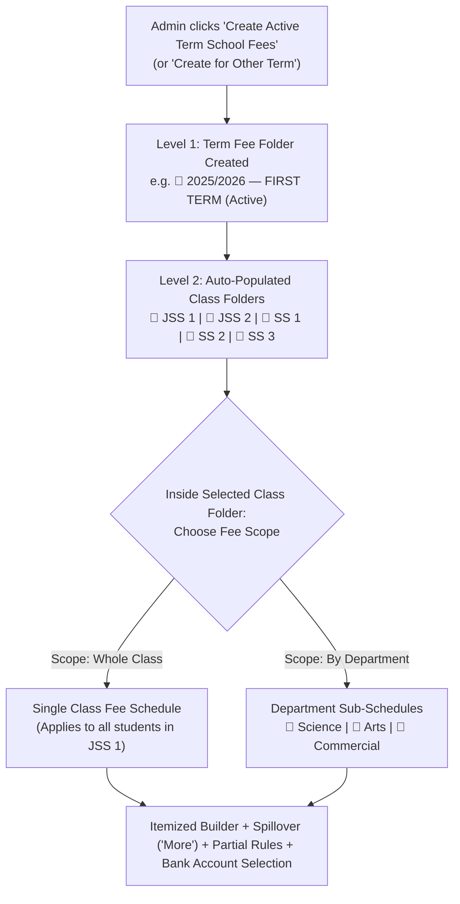
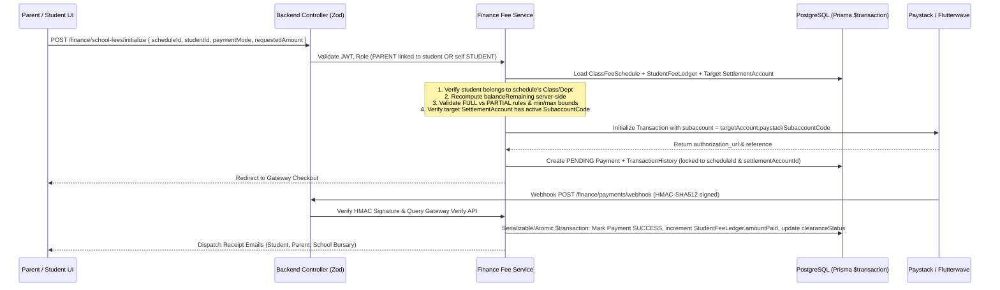

# School Fees Payment & Term Catalog Architecture (`docs/SCHOOL_FEES_PAYMENT_ARCHITECTURE.md`)

> **Subsystem Status**: Architecture & Implementation Blueprint  
> **Owner Subsystems**: `backend/src/modules/finance/`, `frontend/src/app/dashboard/admin/finance/`, `frontend/src/app/dashboard/parent/payments/`, `frontend/src/app/dashboard/student/payments/`, `frontend/src/app/(internal-console)/console/email-templates/`  
> **Related Specs**: [`SUBSCRIPTION_AND_BILLING.md`](SUBSCRIPTION_AND_BILLING.md), [`ADMIN_DASHBOARD_ROLES.md`](ADMIN_DASHBOARD_ROLES.md), [`STUDENT_DASHBOARD.md`](STUDENT_DASHBOARD.md)

---

## 1. Executive Summary & Current System Audit

### 1.1 Purpose
This document defines the end-to-end architecture for **Term- & Class-Scoped School Fees Management, Partial/Full Installment Payments, Multi-Bank Settlement Routing, Parent/Student Overview Widgets, and Automated Email/In-App Notifications** across Qefas Hub.

### 1.2 Audit of Existing Infrastructure (What Already Exists vs. Gaps)

| Layer / File | What Currently Exists | Identified Gaps & Required Upgrades |
|---|---|---|
| **Prisma Schema** ([`backend/prisma/schema.prisma`](../backend/prisma/schema.prisma)) | `SettlementAccount` (lines 1271–1299), `BankAccountAudit` (lines 1301–1325), `Payment` (lines 1227–1249), `TransactionHistory` (lines 1251–1269). | 1. No models for **Term Fee Folders** (`SchoolFeeTermCatalog`), **Class/Department Fee Schedules** (`ClassFeeSchedule`), **Itemized Fee Breakdowns** (`SchoolFeeItem`), or **Student Fee Ledgers** (`StudentFeeLedger`).<br>2. `Payment.parentId` is currently required (`String`), which blocks **Students** from initiating payments directly when no parent account is involved. Must become `String?` with `payerUserId` and `payerRole` (`PARENT \| STUDENT`). |
| **Payment Initialization & Verification** ([`backend/src/modules/finance/services/finance-payments.service.ts`](../backend/src/modules/finance/services/finance-payments.service.ts)) | `initializePaymentService` and `verifyPaymentService` support Paystack & Flutterwave subaccount routing (`paystackSubaccountCode` / `flwSubaccountCode`). | 1. `initializePaymentService` currently trusts a raw `amount` from the client and always routes to `isDefault: true` `SettlementAccount`.<br>2. Needs server-side computation against the class's published `ClassFeeSchedule`, partial-payment validation, and routing to the **admin-selected `SettlementAccount`** on that fee schedule.<br>3. `verifyPaymentService` (lines 140–185) currently hardcodes `"Transcript Clearance Fee Received"` notifications even when `paymentType === 'SCHOOL_FEES'`. Must branch cleanly between `SCHOOL_FEES` and `TRANSCRIPT`. |
| **Admin Finance Portal** ([`frontend/src/app/dashboard/admin/finance/page.tsx`](../frontend/src/app/dashboard/admin/finance/page.tsx)) | Has 2 tabs: **Financial Ledger** (`?tab=ledger`) and **Bank Vault** (`?tab=vault`) with multi-bank account verification and Paystack/Flutterwave subaccounts. | Needs a dedicated **School Fees Catalog (`?tab=school-fees`)** (or `/dashboard/admin/finance/school-fees`) with the **Folder-Based Term -> Class -> Department/Class Fee Builder**, **Auto-Sum & Spillover ("More")** calculator, **Partial Payment Rules**, and **Target Bank Account Selector**. |
| **Parent & Student Portals** ([`frontend/src/app/dashboard/parent/payments/page.tsx`](../frontend/src/app/dashboard/parent/payments/page.tsx)) | Parent has a basic `/dashboard/parent/payments` page that currently uses a static `feeAmount = 150000` placeholder. Student has no `/dashboard/student/payments` page. | 1. **Overview Cards**: Add live School Fees Status & Quick Preview cards to `/dashboard/parent` and `/dashboard/student`.<br>2. **Dedicated Payment Pages**: Upgrade `/dashboard/parent/payments` and create `/dashboard/student/payments` with Full vs. Partial payment selection, itemized breakdown, installment progress bar, and official receipt download. |
| **Email Templates & Console** ([`frontend/src/app/(internal-console)/console/email-templates/page.tsx`](../frontend/src/app/(internal-console)/console/email-templates/page.tsx)) | 19 functional email templates built with `buildEmail()`, `receiptRow()`, `infoCard()`, and `ctaButton()`, testable via `POST /platform/email/test`. | Add **4 new School Fees functional email templates** to both `backend/src/utils/email-template.ts` (or dedicated finance email builder) and `/console/email-templates/page.tsx`. |

---

## 2. Database Schema Architecture (Prisma)

### 2.1 Entity Relationship Diagram

```mermaid
erDiagram
    School ||--o{ SchoolFeeTermCatalog : "has term fee folders"
    Session ||--o{ SchoolFeeTermCatalog : "academic session"
    SettlementAccount ||--o{ SchoolFeeTermCatalog : "default bank account"
    SettlementAccount ||--o{ ClassFeeSchedule : "schedule-specific bank override"

    SchoolFeeTermCatalog ||--o{ ClassFeeSchedule : "contains class folders & schedules"
    Class ||--o{ ClassFeeSchedule : "target class"
    Department ||--o{ ClassFeeSchedule : "optional target department"

    ClassFeeSchedule ||--o{ SchoolFeeItem : "itemized breakdown + spillover"
    ClassFeeSchedule ||--o{ StudentFeeLedger : "tracks per-student balance"

    StudentFeeLedger ||--o{ Payment : "installment or full payments"
    Payment ||--o{ TransactionHistory : "gateway attempts"
```

### 2.2 New & Updated Prisma Models (`backend/prisma/schema.prisma`)

```prisma
enum FeeScheduleScope {
  CLASS       // Applies to all students in the Class
  DEPARTMENT  // Applies only to students in a specific Department within the Class
}

enum FeeCatalogStatus {
  DRAFT
  PUBLISHED
  ARCHIVED
}

enum FeeClearanceStatus {
  UNPAID
  PARTIALLY_PAID
  PAID
  OVERDUE
  WAIVED
}

enum PayerRole {
  PARENT
  STUDENT
  ADMIN_MANUAL
}

/// 1. Term-Level Folder (e.g., "2025/2026 — SECOND Term School Fees")
model SchoolFeeTermCatalog {
  id                        String             @id @default(uuid())
  schoolId                  String
  sessionId                 String
  term                      TermPeriod         // FIRST, SECOND, THIRD
  title                     String             // e.g., "2025/2026 Second Term School Fees"
  description               String?
  isActiveTermCatalog       Boolean            @default(false)
  status                    FeeCatalogStatus   @default(DRAFT)
  defaultSettlementAccountId String?           // Default bank account for all classes in this term folder
  createdById               String
  createdByName             String?
  createdByRole             String?
  publishedAt               DateTime?
  createdAt                 DateTime           @default(now())
  updatedAt                 DateTime           @updatedAt

  school                    School             @relation(fields: [schoolId], references: [id], onDelete: Cascade)
  session                   Session            @relation(fields: [sessionId], references: [id], onDelete: Cascade)
  defaultSettlementAccount  SettlementAccount? @relation("CatalogDefaultBank", fields: [defaultSettlementAccountId], references: [id], onDelete: SetNull)
  schedules                 ClassFeeSchedule[]

  @@unique([schoolId, sessionId, term])
  @@index([schoolId, isActiveTermCatalog])
  @@index([schoolId, status])
}

/// 2. Class / Department Fee Schedule inside a Term Folder
model ClassFeeSchedule {
  id                      String             @id @default(uuid())
  catalogId               String
  schoolId                String
  sessionId               String
  term                    TermPeriod
  classId                 String
  scope                   FeeScheduleScope   @default(CLASS)
  departmentId            String?            // Null when scope == CLASS; required when scope == DEPARTMENT
  currency                String             @default("NGN")
  
  // Pricing & Spillover ("More") Calculation
  itemsSubtotal           Float              @default(0) // Auto-sum of all non-spillover SchoolFeeItems
  spilloverAmount         Float              @default(0) // Auto-calculated: max(0, totalAmount - itemsSubtotal)
  totalAmount             Float              @default(0) // Final payable fee for the term
  isTotalOverridden       Boolean            @default(false)
  spilloverLabel          String             @default("More / Other Charges")

  // Partial Payment Configuration
  allowPartialPayment     Boolean            @default(false)
  minPartialPercentage    Float?             // e.g., 40 means at least 40% required on first installment
  minInstallmentAmount    Float?             // e.g., ₦25,000 minimum per partial payment
  maxInstallments         Int?               @default(3)
  dueDate                 DateTime?

  // Target Bank Account Selection (Overrides catalog's defaultSettlementAccountId if set)
  settlementAccountId     String?

  status                  FeeCatalogStatus   @default(DRAFT)
  publishedAt             DateTime?
  createdById             String
  createdAt               DateTime           @default(now())
  updatedAt               DateTime           @updatedAt

  catalog                 SchoolFeeTermCatalog @relation(fields: [catalogId], references: [id], onDelete: Cascade)
  school                  School               @relation(fields: [schoolId], references: [id], onDelete: Cascade)
  class                   Class                @relation(fields: [classId], references: [id], onDelete: Cascade)
  department              Department?          @relation(fields: [departmentId], references: [id], onDelete: SetNull)
  settlementAccount       SettlementAccount?   @relation("ScheduleBank", fields: [settlementAccountId], references: [id], onDelete: SetNull)
  items                   SchoolFeeItem[]
  studentLedgers          StudentFeeLedger[]

  @@unique([catalogId, classId, departmentId])
  @@index([schoolId, sessionId, term, classId])
  @@index([classId, departmentId, status])
}

/// 3. Itemized Line Items inside a Class/Department Fee Schedule
model SchoolFeeItem {
  id                String           @id @default(uuid())
  scheduleId        String
  name              String           // e.g., "Tuition Fee", "Laboratory Levy", or auto-generated "More / Other Charges"
  amount            Float            // Price in NGN (or school currency)
  isMandatory       Boolean          @default(true)
  isSpillover       Boolean          @default(false) // True for the auto-managed spillover ("More") row
  sortOrder         Int              @default(0)
  createdAt         DateTime         @default(now())
  updatedAt         DateTime         @updatedAt

  schedule          ClassFeeSchedule @relation(fields: [scheduleId], references: [id], onDelete: Cascade)

  @@index([scheduleId, sortOrder])
}

/// 4. Per-Student Term Fee Ledger (Tracks Full vs Partial Payment Progress)
model StudentFeeLedger {
  id                String             @id @default(uuid())
  schoolId          String
  studentId         String
  scheduleId        String
  sessionId         String
  term              TermPeriod
  classId           String
  departmentId      String?
  
  totalBilled       Float              // Snapshot from ClassFeeSchedule.totalAmount
  amountPaid        Float              @default(0)
  balanceRemaining  Float              // Computed: max(0, totalBilled - amountPaid)
  installmentCount  Int                @default(0)
  clearanceStatus   FeeClearanceStatus @default(UNPAID)
  lastPaymentAt     DateTime?
  clearedAt         DateTime?          // Timestamp when balanceRemaining reached 0
  version           Int                @default(1) // Optimistic concurrency lock version

  createdAt         DateTime           @default(now())
  updatedAt         DateTime           @updatedAt

  student           Student            @relation(fields: [studentId], references: [id], onDelete: Cascade)
  schedule          ClassFeeSchedule   @relation(fields: [scheduleId], references: [id], onDelete: Restrict)
  payments          Payment[]

  @@unique([studentId, scheduleId])
  @@index([schoolId, sessionId, term, clearanceStatus])
  @@index([studentId, sessionId, term])
}
```

### 2.3 Required Updates to Existing `Payment` Model
To support both **Parent** and **Student** payers as well as partial installments linked to a `StudentFeeLedger`:

```prisma
model Payment {
  id                   String               @id @default(uuid())
  paymentReference     String               @unique
  studentId            String
  schoolId             String
  parentId             String?              // CHANGED: Nullable so Students can pay directly
  payerUserId          String?              // ID of Parent or Student who initiated the payment
  payerRole            PayerRole            @default(PARENT)
  payerEmail           String?
  payerName            String?
  ledgerId             String?              // Links to StudentFeeLedger for SCHOOL_FEES
  scheduleId           String?              // Links to ClassFeeSchedule
  settlementAccountId  String?              // Selected bank account for this payment
  amount               Float                // Amount paid in THIS installment/payment
  paymentMode          String               @default("FULL") // "FULL" | "PARTIAL"
  installmentNumber    Int                  @default(1)
  balanceBefore        Float?
  balanceAfter         Float?
  currency             String               @default("NGN")
  status               String               @default("PENDING") // PENDING, SUCCESS, FAILED
  gateway              String               @default("PAYSTACK")
  paymentType          String               @default("SCHOOL_FEES") // SCHOOL_FEES, TRANSCRIPT
  term                 String?
  session              String?
  createdAt            DateTime             @default(now())
  updatedAt            DateTime             @updatedAt

  student              Student              @relation(fields: [studentId], references: [id])
  school               School               @relation(fields: [schoolId], references: [id])
  parent               Parent?              @relation(fields: [parentId], references: [id])
  ledger               StudentFeeLedger?    @relation(fields: [ledgerId], references: [id])
  transactions         TransactionHistory[]
}
```

---

## 3. Admin Experience: Folder-Based Term & Class Fee Catalog

### 3.1 Folder Hierarchy & UX Flow (`/dashboard/admin/finance?tab=school-fees`)

The School Fees Catalog uses an intuitive **3-Level Explorer / Folder Metaphor**:



#### Step 1: 1-Click "Create Active Term School Fees" (and "Create for Other Term")
- **Primary CTA**: **"Create Active Term School Fees"** button at the top of `/dashboard/admin/finance?tab=school-fees`.
  - Automatically resolves the school's active `Session` (`isActive: true`) and active `currentTerm` (`FIRST`, `SECOND`, or `THIRD`) using the same resolution priority established across the Admin Dashboard (`Session.currentTerm` -> active `AcademicTermPeriod` date window -> `SchoolSetting.defaultTerm`).
  - Creates the `SchoolFeeTermCatalog` record for `(schoolId, activeSessionId, currentTerm)` if it does not yet exist.
  - Fetches all `Class` records in the school and displays each class as a **Class Sub-Folder** inside the Term Folder, showing its configuration badge (`Unconfigured`, `Draft`, `Published — ₦185,000`, or `3 Departments Configured`).
- **Secondary CTA**: **"Create for Existing Session / Term"** button.
  - Opens a lightweight modal allowing the admin to pick any historical or upcoming `Session` and `Term` (`FIRST`, `SECOND`, `THIRD`) to prepare fees ahead of time or manage arrears for previous terms.

#### Step 2: Inside a Class Folder — Class-Wide vs. Department-Specific
When an admin clicks a **Class Folder** (e.g., `SS 2`):
- **Mode A: Entire Class (`scope: CLASS`)**:
  - One unified fee schedule applies to every student enrolled in `SS 2`.
- **Mode B: By Department (`scope: DEPARTMENT`)**:
  - Displays cards/sub-tabs for each department linked to that class or school (`Science`, `Arts`, `Commercial`, etc.).
  - Admin can configure distinct line items per department (e.g., `Science` includes `"Physics & Chemistry Lab Levy — ₦15,000"`, while `Arts` includes `"Literature Studio Levy — ₦8,000"`), or click **"Copy Items from Another Department/Class"** to speed up setup.

---

### 3.2 Itemized Fee Builder & Spillover ("More") Auto-Sum Algorithm

Requirement #3 specifies:
> *"When creating the school fees for a term, they list the items in the school fees and we can auto sum it up for them or they can edit it and the spill over will be added to the list as more, so the list of items will be the name and the price."*

#### How the Auto-Sum & Spillover ("More") Engine Works:
1. **Standard Line Items (`isSpillover: false`)**:
   - Admin adds rows of `{ name: string, amount: number }` (e.g., `Tuition: ₦100,000`, `Uniform: ₦25,000`, `ICT Levy: ₦15,000`).
   - As rows are typed, the system continuously computes:
     $$\text{itemsSubtotal} = \sum_{i \in \text{nonSpillover}} \text{item}_i.\text{amount}$$
     In the example above, `itemsSubtotal = ₦140,000`.
2. **Auto-Sum Mode (Default — `isTotalOverridden: false`)**:
   - `totalAmount` automatically equals `itemsSubtotal` (`₦140,000`), and `spilloverAmount = 0`. No spillover row is shown.
3. **Custom Total Override & Automatic Spillover Row (`isTotalOverridden: true`)**:
   - The admin can directly edit the **Total Term Fee** input field (for example, changing `₦140,000` to `₦155,000`).
   - Whenever `totalAmount > itemsSubtotal`:
     $$\text{spilloverAmount} = \text{totalAmount} - \text{itemsSubtotal}$$
   - The system **automatically inserts/updates a locked spillover item row** at the bottom of the item list:
     - **Name**: `"More / Other Charges"` (editable label if admin wishes, defaults to `"More"`)
     - **Price**: `₦15,000` (`155,000 - 140,000`)
     - **Badge**: `Auto-Spillover`
   - If the admin later adds another item (e.g., `Sports Wear: ₦5,000`), `itemsSubtotal` becomes `₦145,000` and the `"More"` spillover row automatically adjusts to `₦10,000` (`155,000 - 145,000`), or if `itemsSubtotal >= totalAmount`, the spillover row automatically disappears (`spilloverAmount = 0`) and `totalAmount` updates to `itemsSubtotal`!

```ts
// Pure deterministic calculation shared by Frontend preview & Backend Zod service validation
export function reconcileFeeScheduleItems(
  manualItems: Array<{ name: string; amount: number; sortOrder?: number }>,
  customTotalAmount?: number | null,
  spilloverLabel = 'More'
) {
  const cleanItems = manualItems.map((item, idx) => ({
    name: item.name.trim(),
    amount: Math.max(0, Number(item.amount) || 0),
    isSpillover: false,
    sortOrder: idx,
  }));

  const itemsSubtotal = cleanItems.reduce((sum, item) => sum + item.amount, 0);

  if (customTotalAmount !== undefined && customTotalAmount !== null && customTotalAmount > itemsSubtotal) {
    const spilloverAmount = Number((customTotalAmount - itemsSubtotal).toFixed(2));
    return {
      itemsSubtotal,
      spilloverAmount,
      totalAmount: Number(customTotalAmount.toFixed(2)),
      isTotalOverridden: true,
      reconciledItems: [
        ...cleanItems,
        {
          name: spilloverLabel,
          amount: spilloverAmount,
          isSpillover: true,
          sortOrder: cleanItems.length,
        },
      ],
    };
  }

  return {
    itemsSubtotal,
    spilloverAmount: 0,
    totalAmount: itemsSubtotal,
    isTotalOverridden: false,
    reconciledItems: cleanItems,
  };
}
```

---

### 3.3 Partial Payment Configuration & Target Bank Account Selection

Within the same Class/Department Fee Schedule editor (and optionally at the Term Folder level as defaults):

1. **Allow Partial Payments Toggle (`allowPartialPayment: boolean`)**:
   - **OFF**: Parents and Students can only pay `100%` of the `totalAmount` in a single checkout.
   - **ON**: Admin can configure:
     - **Minimum Initial Payment Percentage (`minPartialPercentage`)**: e.g., `40%` (Student/Parent must pay at least 40% on the first installment).
     - **Minimum Installment Floor (`minInstallmentAmount`)**: e.g., `₦10,000` (prevents micro-transactions unless the remaining balance itself is less than `₦10,000`, in which case they must pay the exact remaining balance).
     - **Maximum Installments (`maxInstallments`)**: e.g., `3` installments per term.
     - **Final Payment Due Date (`dueDate`)**: Date after which unpaid balances are flagged as `OVERDUE`.

2. **Target Receiving Bank Account Selector (`settlementAccountId`)**:
   - Dropdown populated from the school's verified `SettlementAccount` records in the **Bank Vault** (`GET /finance/bank-accounts`).
   - Displays Bank Name, Masked/Full Account Number, Account Name, and Verification Badge (`Verified Subaccount`).
   - Admin can set a **Default Bank Account for the Term Folder** (e.g., *"Zenith Bank — 1023456789 (Tuition Collection Account)"*) and optionally override it for specific classes (e.g., *"GTBank — 0123456789 (Senior Secondary Account)"*).

---

## 4. Parent & Student Experience

### 4.1 Dashboard Overview Status Card & Quick Preview Modal
On both:
- **Parent Dashboard Overview**: [`frontend/src/app/dashboard/parent/page.tsx`](../frontend/src/app/dashboard/parent/page.tsx)
- **Student Dashboard Overview**: [`frontend/src/app/dashboard/student/page.tsx`](../frontend/src/app/dashboard/student/page.tsx)

#### Overview Widget Features:
- **Header**: `"School Fees Status"` with Active Session & Term pill (e.g., `2025/2026 • Second Term`) and Class/Department badge (`SS 2 • Science`).
- **Clearance Status Badge**:
  - `PAID` (Emerald badge: *"Cleared for Term"*)
  - `PARTIALLY_PAID` (Amber badge: *"Partial — 60% Paid"*)
  - `UNPAID` / `OVERDUE` (Rose badge: *"Payment Required"*)
- **Financial Progress Metrics**:
  - **Total Term Fee**: `₦155,000`
  - **Amount Paid**: `₦90,000`
  - **Remaining Balance**: `₦65,000`
  - Visual progress bar showing percentage cleared.
- **2 Action Buttons**:
  1. **"Quick Preview"**: Opens `SchoolFeesQuickPreviewModal` right on the overview page without navigating away. Shows:
     - Every line item (`Tuition`, `Lab Levy`, `Uniform`, plus `"More"` spillover if present) and total.
     - Partial payment policy (e.g., *"Partial payments allowed • Min 40% initial payment"*).
     - Installment payment history with receipt download links.
  2. **"Pay Now" / "Complete Balance"**: Navigates directly to `/dashboard/parent/payments` or `/dashboard/student/payments`.

---

### 4.2 Dedicated School Fees Payment Page
- **Parent Route**: [`frontend/src/app/dashboard/parent/payments/page.tsx`](../frontend/src/app/dashboard/parent/payments/page.tsx)
- **Student Route**: `frontend/src/app/dashboard/student/payments/page.tsx` (New dedicated route + sidebar navigation item in Student Sidebar)

#### Key Sections of the Dedicated Payment Page:
1. **Context Selector Bar**:
   - **Parent View**: Child Switcher (`Select Child`) + Term/Session Switcher (defaults to Active Term, allows switching to view past receipts or pay arrears for another published term).
   - **Student View**: Locked to the logged-in Student's profile + Term/Session Switcher.
2. **Itemized Fee Schedule Card**:
   - Displays all line items from `ClassFeeSchedule.items` (including the `"More"` spillover item if applicable), the target Class/Department, due date, and official school verification seal.
3. **Interactive Payment Mode Selector**:
   - **Option 1: Pay Full Balance (`₦155,000` or remaining `₦65,000`)** — Always available when `balanceRemaining > 0`.
   - **Option 2: Pay Partial / Installment** — Enabled when `schedule.allowPartialPayment === true` and `installmentCount < maxInstallments`:
     - Quick percentage chips (`40%`, `50%`, `75%`) + Custom Amount input (`₦`).
     - Real-time validation feedback showing minimum allowed installment and resulting remaining balance after payment.
     - If `installmentCount === maxInstallments - 1` (final allowed installment), partial input locks to the exact `balanceRemaining` so the student clears their balance within the allowed installment count.
4. **Payment History & Official Printable Receipt**:
   - Lists every installment (`Installment #1 of 3 — ₦90,000 — SUCCESS`), transaction reference, date paid, and a **"Download Official Receipt (PDF)"** button.

---

## 5. Extreme Security & Financial Integrity Architecture

Requirement #7 mandates:
> *"Make sure this whole process is extremely secure and the admin can select which bank account they want to be receiving the money for the school fees into."*

### 5.1 Seven-Layer Defense-in-Depth Model



### 5.2 Strict Security Invariants
1. **Zero Trust on Client Amounts**:
   - For `paymentMode === 'FULL'`, the backend **ignores** any client-supplied amount and charges `ledger.balanceRemaining` (or `schedule.totalAmount` if no payments have been made yet).
   - For `paymentMode === 'PARTIAL'`, the backend verifies:
     - `schedule.allowPartialPayment === true`
     - `ledger.installmentCount < (schedule.maxInstallments ?? 10)`
     - If it is the final allowed installment (`ledger.installmentCount + 1 === schedule.maxInstallments`), `amount` MUST equal `ledger.balanceRemaining`.
     - Otherwise, `amount >= minAllowedAmount` and `amount <= ledger.balanceRemaining`.
2. **Relationship & Enrollment Authorization Gate**:
   - If `req.user.role === 'STUDENT'`, `req.user.id` MUST match `studentId`.
   - If `req.user.role === 'PARENT'`, the backend verifies an active `ParentStudent` or `RelationshipLink` (`status: 'ACTIVE'`) between `parentId` and `studentId`.
   - The student's enrolled `classId` (and `departmentId` when `scope === 'DEPARTMENT'`) MUST match the `ClassFeeSchedule`.
3. **Target Bank Account (`SettlementAccount`) Subaccount Enforcement**:
   - The receiving `SettlementAccount` is resolved on the server via:
     $$\text{targetAccount} = \text{schedule.settlementAccount} \;\Vert\; \text{catalog.defaultSettlementAccount} \;\Vert\; \text{school.defaultSettlementAccount}$$
   - The backend verifies that `targetAccount.schoolId === schedule.schoolId`, `targetAccount.isVerified === true`, and its gateway subaccount code (`paystackSubaccountCode` or `flwSubaccountCode`) is present. Clients can **never** pass a `settlementAccountId` or `subaccountCode` in the checkout payload.
4. **Gateway Amount & Currency Reconciliation**:
   - During verification (`verifyPaymentService` & Webhook), the backend checks that the amount confirmed by Paystack/Flutterwave (`gatewayAmountKobo / 100`) is `>= payment.amount` and `currency === payment.currency`.
5. **Idempotent Atomic Ledger Updates (`prisma.$transaction`)**:
   - Webhook and callback verification can arrive simultaneously. Inside `prisma.$transaction`, the service performs an atomic conditional update:
     ```ts
     const updated = await tx.payment.updateMany({
       where: { id: payment.id, status: { not: 'SUCCESS' } },
       data: { status: 'SUCCESS' }
     });
     if (updated.count === 0) return existingSuccessReceipt; // Already processed idempotently!
     ```
   - Only when `updated.count === 1` does the transaction increment `StudentFeeLedger.amountPaid`, decrement `balanceRemaining`, increment `installmentCount`, and transition `clearanceStatus` (`PARTIALLY_PAID` or `PAID`).
6. **RBAC & Bank Account Audit Trail**:
   - Only admins passing `canAdminRoleAccessFeature(adminRole, 'finance')` (`SCHOOL_OWNER`, `PRINCIPAL`, `ACCOUNTANT`) can create, edit, publish, or change the target bank account on a `SchoolFeeTermCatalog` or `ClassFeeSchedule`.
   - Every change to a catalog's target bank account or total fee amount after publication writes an immutable audit log entry in `BankAccountAudit`.

---

## 6. Email & In-App Notifications + Console Email Templates

Requirements #8 and #9 mandate:
> *"8. Make sure a notification for all this to their email is set up."*  
> *"9. Make sure the email notification templates for all this are added to the console email template page."*

### 6.1 The 4 New School Fees Email Templates

All 4 templates use the standard Qefas Hub email builder (`buildEmail`, `receiptRow`, `infoCard`, `ctaButton`) in [`backend/src/utils/email-template.ts`](../backend/src/utils/email-template.ts) and must be registered in [`frontend/src/app/(internal-console)/console/email-templates/page.tsx`](../frontend/src/app/(internal-console)/console/email-templates/page.tsx) as well as [`backend/src/modules/platform/platform.controller.ts`](../backend/src/modules/platform/platform.controller.ts) (`POST /platform/email/test`):

| Template ID | Title in `/console/email-templates` | Trigger Event | Recipients | Key Content & Receipt Rows |
|---|---|---|---|---|
| `school-fees-published` | **School Fees Published (Term Invoice)** | Admin publishes a `ClassFeeSchedule` or `SchoolFeeTermCatalog` | All Students in the class/department + their linked Parents | School Name, Session & Term, Class/Department, Itemized Breakdown (including `"More"` spillover row if present), Total Amount, Partial Payment Policy (`Allowed` / `Full Only`), Due Date, CTA to Pay School Fees. |
| `school-fees-receipt` | **School Fees Payment Receipt (Full / Partial)** | `verifyPaymentService` confirms `SUCCESS` for `paymentType === 'SCHOOL_FEES'` | Payer (Parent or Student) + Student + linked Parent(s) | Payment Mode (`FULL PAYMENT` or `PARTIAL INSTALLMENT #N`), Amount Paid Now, Previous Paid, Cumulative Paid, **Remaining Balance**, Clearance Status (`CLEARED` vs `PARTIALLY PAID`), Transaction Reference, Session/Term/Class, CTA to View/Download PDF Receipt. |
| `school-fees-admin-alert` | **School Fees Received (Bursary Alert)** | `verifyPaymentService` confirms `SUCCESS` for `paymentType === 'SCHOOL_FEES'` | School Owner, Principal, Accountant (`adminRole IN ('SCHOOL_OWNER', 'PRINCIPAL', 'ACCOUNTANT')`) | Student Name & Code, Class/Department, Payer Name & Role (`Parent` / `Student`), Amount Paid, Remaining Student Balance, **Target Settlement Bank Account (`bankName` + masked `accountNumber`)**, Gateway Reference, CTA to Finance Ledger. |
| `school-fees-payment-failed` | **School Fees Payment Failed** | Payment verification returns `FAILED` / `ABANDONED` | Payer (Parent or Student) | Student Name, Attempted Amount, Term & Class, Failure Reason, Reference ID, Safe Retry CTA to `/dashboard/parent/payments` or `/dashboard/student/payments`. |

### 6.2 Console Email Templates Registration Blueprint
In [`frontend/src/app/(internal-console)/console/email-templates/page.tsx`](../frontend/src/app/(internal-console)/console/email-templates/page.tsx), append the 4 templates to the `templates` array with `isFunctional: true` and `badge: "Functional"`:
1. `id: "school-fees-published"` (`icon: "FolderKanban"`, `color: "indigo"`)
2. `id: "school-fees-receipt"` (`icon: "Receipt"`, `color: "emerald"`)
3. `id: "school-fees-admin-alert"` (`icon: "Landmark"`, `color: "blue"`)
4. `id: "school-fees-payment-failed"` (`icon: "AlertOctagon"`, `color: "red"`)

And in `backend/src/modules/platform/platform.controller.ts` (or email test service), handle those 4 `templateId` values so platform admins can send live test emails directly from `/console/email-templates`.

---

## 7. Modular Backend & Frontend File Blueprint

Following the **Flexiti 3-Layer Backend Architecture** and **Modular Component Rule (<300–400 lines per file)** in [`.agents/AGENTS.md`](../.agents/AGENTS.md):

### 7.1 Backend Structure (`backend/src/modules/finance/`)
```
backend/src/modules/finance/
├── controllers/
│   ├── finance-catalog.controller.ts       # Thin handlers for Term Folders & Class/Dept Schedules
│   ├── finance-student-fees.controller.ts  # Thin handlers for Parent/Student overview & payment init
│   └── index.ts                            # Barrel re-exporting all finance controllers
├── services/
│   ├── finance-catalog.service.ts          # Create Active Term folder, auto-populate class folders, item spillover math, publish & notify
│   ├── finance-student-fees.service.ts     # Student/Parent fee status, quick preview, ledger computation
│   ├── finance-payments.service.ts         # Upgraded: server-side fee validation, schedule bank routing, SCHOOL_FEES vs TRANSCRIPT verification
│   └── finance-emails.service.ts           # HTML builders & dispatchers for the 4 school fees emails
├── schemas/
│   └── finance-catalog.schemas.ts          # Strict Zod schemas for Term Catalog, Class Schedule, Line Items, and Checkout Init
└── finance.routes.ts                       # Express routes wired with Zod validation & RBAC middleware
```

### 7.2 API Endpoints Summary

| Method & Route | Access Role | Description |
|---|---|---|
| `POST /finance/catalogs/active-term` | Admin (`finance`) | 1-click auto-creates the Term Folder for the school's active `Session` & `currentTerm` and returns all class sub-folders. |
| `POST /finance/catalogs` | Admin (`finance`) | Creates a Term Folder for any chosen `sessionId` and `term`. |
| `GET /finance/catalogs` | Admin (`finance`) | Lists all Term Fee Folders for the school with class completion stats. |
| `GET /finance/catalogs/:catalogId` | Admin (`finance`) | Returns the Term Folder, all school classes (as folders), and configured class/department schedules. |
| `PUT /finance/catalogs/:catalogId/schedules` | Admin (`finance`) | Creates or updates a `ClassFeeSchedule` (`scope: CLASS \| DEPARTMENT`), runs `reconcileFeeScheduleItems()` to compute auto-sum & `"More"` spillover, sets partial payment rules, and assigns `settlementAccountId`. |
| `POST /finance/schedules/:scheduleId/publish` | Admin (`finance`) | Publishes a schedule (or entire term catalog), materializes/updates `StudentFeeLedger` rows, and dispatches `school-fees-published` emails + in-app notifications. |
| `GET /finance/school-fees/my-overview` | `PARENT`, `STUDENT` | Returns active term fee status, paid/remaining amounts, partial payment eligibility, and itemized breakdown for the student (or parent's selected child). |
| `POST /finance/school-fees/initialize` | `PARENT`, `STUDENT` | Server-validated payment initialization (`FULL` or `PARTIAL`) routed to the schedule's selected `SettlementAccount`. |
| `GET /finance/payments/verify/:reference` | Authenticated | Verifies payment atomically, updates `StudentFeeLedger`, and triggers `school-fees-receipt` & `school-fees-admin-alert` emails. |

### 7.3 Frontend Component Structure (`frontend/src/app/dashboard/`)
```
frontend/src/app/dashboard/
├── admin/finance/
│   ├── page.tsx                                         # Adds "School Fees Catalog" tab alongside Ledger & Bank Vault
│   └── components/school-fees/
│       ├── TermCatalogExplorer.tsx                      # Top-level Term Folders + "Create Active Term School Fees" CTA
│       ├── CreateTermCatalogModal.tsx                   # Modal to create folder for other existing terms/sessions
│       ├── ClassFolderGrid.tsx                          # Displays all classes inside a Term Folder
│       ├── ClassFeeScheduleEditor.tsx                   # Class vs Department toggle, Partial Payment rules, Bank Account selector
│       └── FeeItemsSpilloverBuilder.tsx                 # Dynamic line items + auto-sum + editable total with "More" spillover row
├── parent/
│   ├── components/ParentSchoolFeesStatusCard.tsx        # Overview widget on /dashboard/parent
│   └── payments/
│       ├── page.tsx                                     # Upgraded dedicated Parent School Fees Payment page
│       └── components/
│           ├── SchoolFeesQuickPreviewModal.tsx          # Shared Quick Preview modal (itemized breakdown + installments)
│           ├── PartialOrFullPaymentCard.tsx             # Interactive Full vs Partial selector with validation
│           └── SchoolFeeReceiptModal.tsx                # Printable official school fee clearance receipt
└── student/
    ├── components/StudentSchoolFeesStatusCard.tsx       # Overview widget on /dashboard/student
    └── payments/
        └── page.tsx                                     # New dedicated Student School Fees Payment page
```

---

## 8. Step-by-Step Implementation Order

When executing this blueprint, implement in the following 5 phases to guarantee zero regression:

1. **Phase 1 — Prisma Schema & Migration**:
   - Add `SchoolFeeTermCatalog`, `ClassFeeSchedule`, `SchoolFeeItem`, and `StudentFeeLedger` to [`backend/prisma/schema.prisma`](../backend/prisma/schema.prisma) and make `Payment.parentId` optional (`String?`). Run `npx prisma generate` and migration.
2. **Phase 2 — Backend Catalog, Spillover Math & Secure Checkout Services**:
   - Build `finance-catalog.service.ts`, `finance-student-fees.service.ts`, and upgrade `finance-payments.service.ts` (separating `SCHOOL_FEES` vs `TRANSCRIPT` verification and routing to the schedule's `settlementAccountId`).
3. **Phase 3 — Email Templates & Internal Console Integration**:
   - Add the 4 email builders to `backend/src/utils/email-template.ts`, wire them into `verifyPaymentService` and `publishScheduleService`, and register them in [`frontend/src/app/(internal-console)/console/email-templates/page.tsx`](../frontend/src/app/(internal-console)/console/email-templates/page.tsx) and `POST /platform/email/test`.
4. **Phase 4 — Admin School Fees Folder & Schedule UI**:
   - Add the **School Fees Catalog** tab to [`frontend/src/app/dashboard/admin/finance/page.tsx`](../frontend/src/app/dashboard/admin/finance/page.tsx) with 1-click Active Term creation, Class/Department folders, Auto-Sum + `"More"` spillover editor, Partial Payment settings, and Bank Account picker.
5. **Phase 5 — Parent & Student Overview Cards + Dedicated Payment Pages**:
   - Add the Overview Status & Quick Preview cards to `/dashboard/parent` and `/dashboard/student`, upgrade `/dashboard/parent/payments`, and create `/dashboard/student/payments`.

